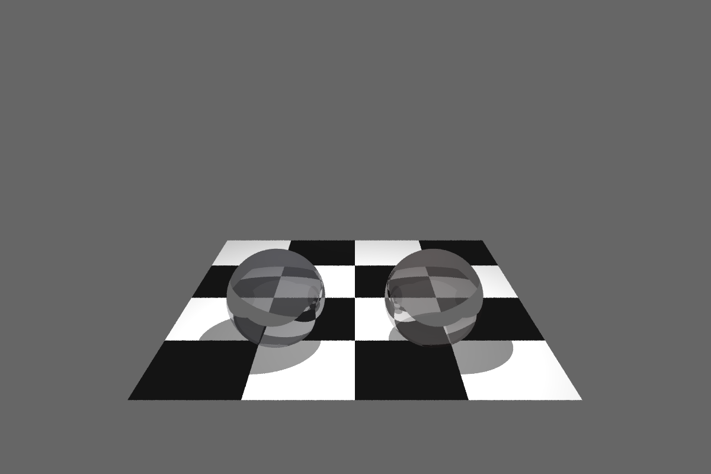
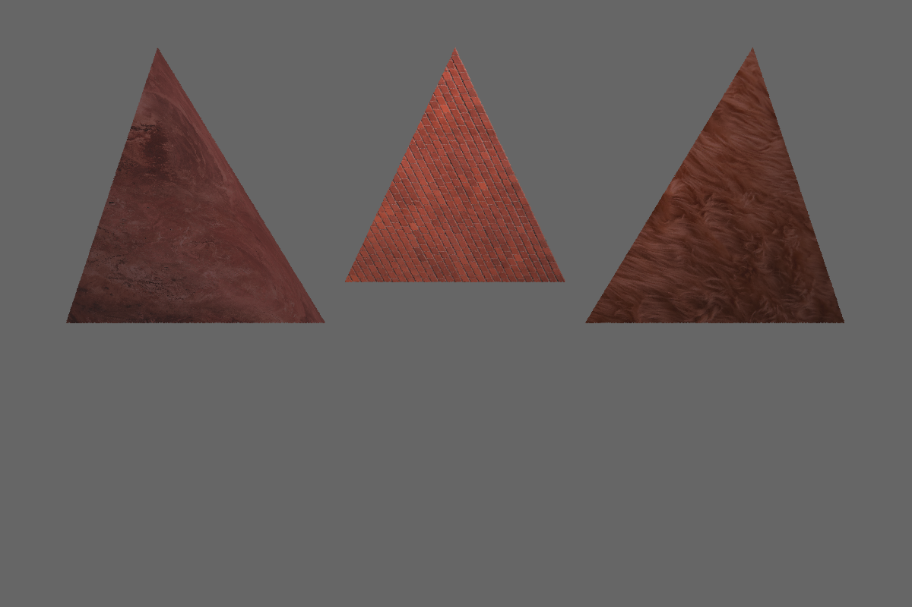
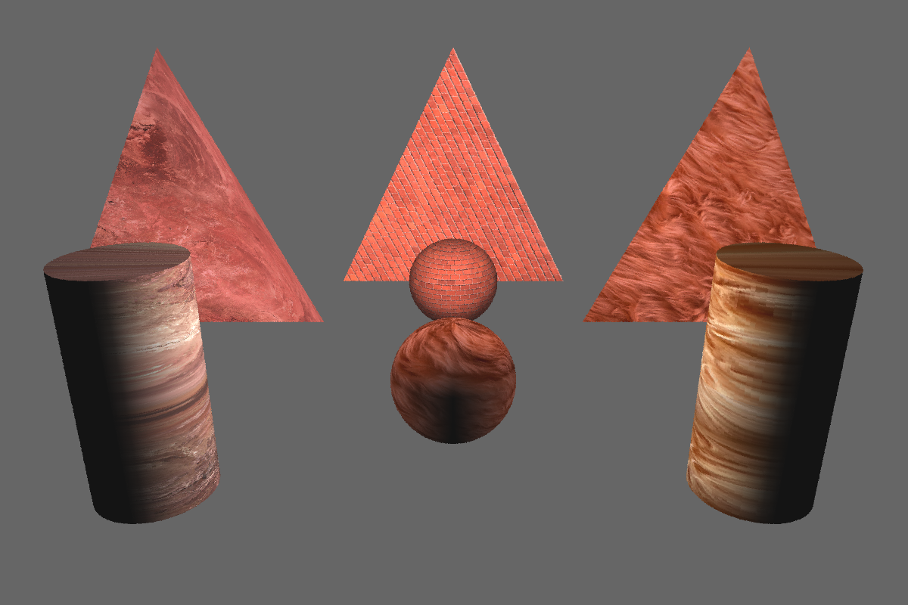

# Ray tracer
This is my implementation of a ray tracer written from scratch in C++.

# Features
- Image write (PPM)
- Camera implementation with coordinate transformation
- Intersection tests for:
    - Spheres
    - Cylinders
    - Triangle planes
- Blinn-Phong shading
- Shadows
- Reflection
- Refraction
- Textures (on Cylinders, Spheres, Triangle planes)
- Anti-aliasing

# Example renders

## Reflection and refraction
Fresnal (both reflection and refraction)

## Textures
Sphere

Cylinder 

Triangles

All

