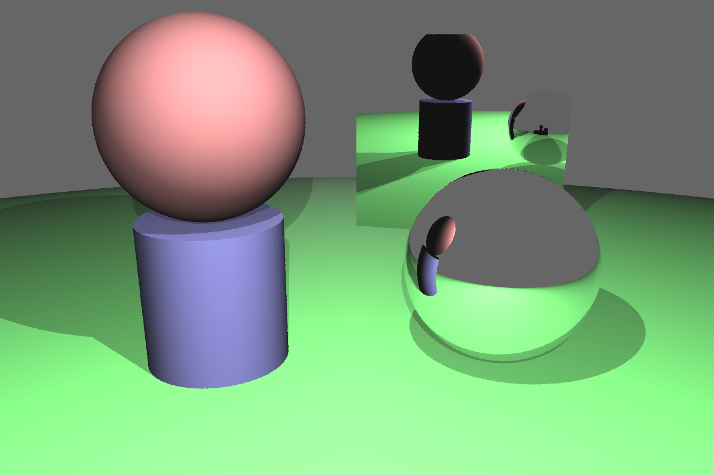
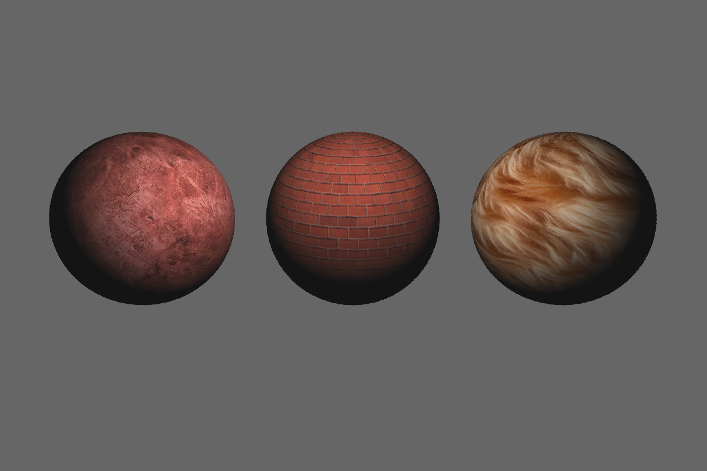
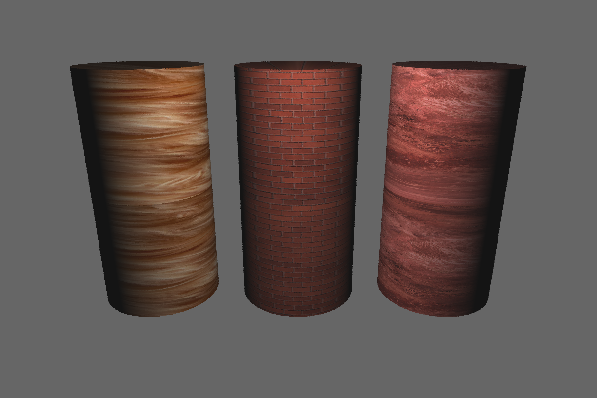

# Ray tracer
This is my implementation of a ray tracer written from scratch in C++.

## Features
- Image write (PPM)
- Camera implementation with coordinate transformation
- Intersection tests for:
    - Spheres
    - Cylinders
    - Triangle planes
- Blinn-Phong shading
- Shadows
- Reflection
- Refraction
- Textures (on Cylinders, Spheres, Triangle planes)
- Anti-aliasing
- Tone mapping (happens if dynamic range is too high automatically)
- Bounding Volume hierarchy (reduces render time, more details in Optimisations)

## Compilation instructions
To compile the program, run the `make` command in the root directory to compile the program. This will create an file called 'program'. 

## Execution instructions
The ray tracer takes input from a .json file. Example json files can be found in `./input-json`. To run the ray tracer on a given file name, execute the command `./program {insert-path-to-json}.json`. This will create a `PPM` file which is our rendered scene. 

To view the output, either load the file in GIMP, or if you are using VSCode, download the extension <a href="https://marketplace.visualstudio.com/items?itemName=ngtystr.ppm-pgm-viewer-for-vscode">here</a> to view it in your IDE.

## Optimisations

### Bounding volume hierarchy (BVH)
By adding BVH to my ray tracer, scenes render much quicker as we leverage a tree-like datastructure filled with primitives (objects in the scene) and their associated 'bounding boxes'. Then, we only look inside the 'bounding boxes' of the primitives in the tree until we are done. Some example of optimisations are below:

- Scene.json
    - Without BVH: ~9.16 seconds
    - With BVH ~8.04 seconds

## Example renders

### Reflection and refraction
Fresnal (both reflection and refraction)

### Textures
Sphere

Cylinder 

Triangles

All

